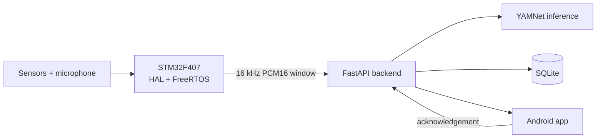

# Smart Baby Monitoring System — Project Report Draft

## 1. Objective

Build an educational IoT baby-monitor prototype on the RT-Thread RT-Spark STM32F407 board using STM32Cube HAL and FreeRTOS, with environmental sensing, bounded audio capture, backend cry classification, a local FastAPI/SQLite service, and an Android caregiver app. The prototype is not a medical or safety-certified device.

## 2. Architecture

The onboard RW007 transport joins a 2.4 GHz AP, obtains DHCP, and posts real sensor telemetry over TLS 1.2 using ECDHE-RSA-AES128-GCM-SHA256 with a pinned local CA. A Caddy terminator reverse-proxies HTTPS to FastAPI; the board’s authenticated 64 KB audio-window POST is accepted by the backend. The firmware has a bounded telemetry queue and post-recovery drain; a 30 s AP outage trial reconnected and drained without losing an accepted event. Controlled cry capture-to-notification remains the main hardware evidence gap.

## 3. Component inventory

| Component | Verified use |
|---|---|
| STM32F407ZGTx, 1 MiB flash | 168 MHz from 8 MHz HSE/PLL; SWD flash/debug |
| USART1 PA9/PA10 | 115200 console through the ST-Link VCP |
| PF12 / PF11 LEDs | PF12 red LED 1 Hz task indicator |
| AHT21 temperature/humidity | Soft I²C3, PE0/PE1, address 0x38 |
| AP3216C light/proximity | Soft I²C2, PF0/PF1, address 0x1E |
| ICM20608 accelerometer/gyro | Same I²C2 bus, address 0x68, `WHO_AM_I=0xAF` |
| ES8388 + 3.5 mm microphone | Codec at 0x10; I2S3 master, I2S3ext RX, DMA1 |
| RW007 Wi-Fi | SPI link, Wi-Fi join, DHCP, pinned-CA TLS 1.2 AES-GCM, real sensor telemetry, 64 KB audio-window POST, and bounded outage queue verified; controlled cry capture-to-notification pending |
| ST7789 LCD, buttons, buzzer | Pins/control not yet implemented |
| Android phone/emulator | API 35 emulator; APK connected to local backend |

## 4. Firmware design

Five FreeRTOS tasks are created:

| Task | Priority | Stack (words) | Current behavior |
|---|---:|---:|---|
| Sensors | 4 | 256 | Initializes and reads AHT21/AP3216C/ICM20608 every second |
| Audio | 5 | 384 | ES8388 + I2S3ext DMA, RMS/peak logging, 2 s activity-gated mono window |
| Network | 2 | 2048 | RW007 + lwIP DHCP/TCP; authenticated telemetry POST verified |
| Local UI | 3 | 256 | PF12 blink |
| Health | 1 | 256 | 1 Hz heap/stack/health logging |

Latest measured build: 73,364 B of 131,072 B main SRAM (plus the 64 KiB CCM audio window); 139,356 B of 1,048,576 B flash. Runtime health logs show 9,448 B minimum free of 24,576 B FreeRTOS heap and stack high-water 96/236/142/233/125 words (Sensors/Audio/Network/LocalUI/Health). Tick is 1 kHz. The sensor bus uses a FreeRTOS mutex shared with the codec.

### Audio

- ES8388 configured from the Spark-1 BSP sequence.
- STM32 I2S3 master TX supplies clocks and silence; I2S3ext slave RX receives codec ADC data on PB4.
- DMA1 Stream0 Channel3 RX (the reference-manual I2S3ext RX row is wrong) and Stream5 Channel0 TX.
- 16 kHz stereo PCM16, 1024-sample circular DMA buffer; measured half-buffer period 15.7 ms for 512 samples.
- Downmixed into a 32,000-sample mono window after the provisional RMS gate (800) triggers; window completion and RAM-dump RMS/peak were verified.
- No continuous audio is streamed or stored by default.

## 5. Classifier and backend

- Pretrained YAMNet (`baby cry, infant cry`), backend inference; TensorFlow CPU 2.21.0 / Hub 0.16.1.
- Decision rule: threshold plus two adjacent YAMNet frames; default threshold 0.35.
- Backend stores readings, events, acknowledgements, and inference status in SQLite; 15 backend tests pass.
- Held-out ESC-50 evaluation: 20 unseen cry + 20 unseen non-cry clips, source-disjoint; test precision 1.000, recall 0.850, F1 0.919 at threshold 0.05; precision 1.000, recall 0.800, F1 0.889 at default 0.35; zero false positives in this set. See `docs/ml-evaluation.md`.
- Limitations: ESC-50 is small and source-dependent; speech, music, and silence confusers were not included; the max-RMS window selection may overstate performance.

## 6. Android app

- Jetpack Compose dashboard, History, Settings, and acknowledgement flow.
- Token encrypted with Android Keystore; release builds require HTTPS. The debug build has a local-only cleartext allowance for `10.0.2.2`.
- Verified on API 35 emulator: live readings, history, search, acknowledgement, dark theme, 1.5× text, landscape, API-error state, stale/offline state, safe drawing insets, and a local `Possible baby cry` notification.
- Ten local notification trials delivered 10/10; API-event-to-app notification latency min 5.38 s, median 14.18 s, p95 14.6 s, max 14.93 s. This is polling latency, not capture-to-notification, and FCM remains unconfigured.

## 7. Safety and privacy

- No electronics or cables are attached to an infant; testing uses a classroom fixture and licensed audio.
- Proximity is a placement/obstruction indication only; device motion is not infant movement; cry classification does not diagnose a condition.
- Missing readings, stale inference, network loss, and exhausted queues are explicit faults, never evidence of safety.
- Only bounded triggered windows are intended for upload; the backend processes audio in memory and does not persist raw audio.
- The local bench bridge and debug HTTP path are development aids, not a deployment design.

## 8. Outstanding work

1. Controlled acoustic cry source and 10 microphone-to-app trials with latency/delivery records; keep the earlier API-to-app polls separate.
2. Real FCM delivery once project credentials exist; local notification fallback is verified.
3. Display/buttons/buzzer and local acknowledge/mute.
4. Speech/music/silence confusers and a larger independent test set.
5. Demonstration video, final report formatting, and tagged submission. Do not tag until item 1 is recorded.
