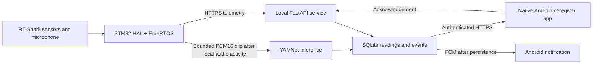

# System Design

## Data flow

## Target firmware task model

The current firmware schedules five tasks. The sensor task reads the verified AHT21, AP3216C, and ICM20608 once per second and publishes bounded telemetry samples. The audio task configures the ES8388, receives 16 kHz stereo PCM16 through I2S3ext + DMA, downmixes to a 2 s mono window when the RMS gate triggers, and reports RMS/peak/timing. The network task uploads the window over pinned-CA TLS 1.2 AES-GCM, receives the backend classification, and alternates telemetry/audio so a continuously ready window does not starve telemetry. Ten real microphone-to-app cry trials are recorded; audio gain calibration and a physical-fixture video remain. The LocalUI task now drives the onboard ST7789 status pages, KEY0–KEY2/WK_UP controls, blue alert LED, and PB0 buzzer; display pixels and physical controls still need human confirmation.

- DMA interrupt captures microphone samples and wakes the audio task. The acquisition callback does not perform network work or model inference.
- Sensor task samples the verified AHT21 (soft I²C3, PE0/PE1), AP3216C and ICM20608 (soft I²C2, PF0/PF1) every second and overwrites a latest-value queue. Raw values are logged with the I²C scan at boot; the driver must not infer infant presence, breathing, or movement.
- Audio task runs local activity gating, prepares a maximum two-second clip, and queues it for transport. No continuous raw audio is retained or streamed.
- Network task sends telemetry every five seconds and only triggered audio clips. It uses bounded queues and reconnect backoff; a failed network does not block sensor acquisition.
- UI/alarm task updates the display/LED/buzzer and reads local acknowledge/mute/test actions.
- Health/log task records fault counters, task stack high-water marks, heap, and watchdog health where configured.

The current task priorities and stack sizes are provisional. Bus instances, pins, clock source, TLS transport, and actual task behavior must be measured after board verification.

## API contract

- `POST /api/v1/devices/{device_id}/telemetry`: UTC capture time, sequence, temperature, humidity, light, proximity state, device tilt, Wi-Fi RSSI, firmware version, and sensor faults.
- `POST /api/v1/devices/{device_id}/audio-windows`: exactly two seconds of 16 kHz, mono, signed PCM16 plus capture-time, sequence, and sample-rate headers. The route accepts bounded input only and never persists the body. Negative sequences and capture times more than 30 seconds in the future are rejected. A retry with the same device, UTC capture time, and sequence returns the stored result instead of creating another event.
- `GET /api/v1/devices/{device_id}/latest` and `GET /api/v1/readings`: latest and historical readings for the app. The latest response also reports whether the device has contacted the backend recently, the inference state (`unknown`, `unavailable`, `stale`, `crying`, or `background`) with capture/check timestamps, and the configured demonstration alert rules.
- `GET /api/v1/events`: chronological events, filterable by device.
- `POST /api/v1/events/{event_id}/acknowledgement`: idempotent caregiver acknowledgement.
- `POST /api/v1/app/installations`: register an Android FCM installation token.
- `/health`: service readiness only; it does not assert that the monitoring environment is safe.

Device and app credentials are separate bearer tokens. Device upload uses TLS; production Firebase service credentials stay on the backend.

## Alert behavior

- The cry threshold (default 0.35) is a demonstration value until calibrated on validation data with recall prioritized. A cry event requires two adjacent model frames above threshold and is keyed by device/audio sequence to prevent retry duplicates.
- A cry episode stays open while classified crying continues and is not re-armed by caregiver acknowledgement. Three consecutive background windows clear it; a gap of more than 120 seconds between classified windows also clears it, because continuity is unknown. Background-only windows are stored as metadata but never as cry events.
- Environment settings start at 18–30 °C and 30–70% RH as demonstration comfort bands only. An alert is generated after three consecutive readings outside a band and remains one event until readings return in range.
- Sensor faults, stale data, network loss, inference unavailability, and queue exhaustion are explicit fault states. They never imply that no cry is occurring or that conditions are safe.
- FCM delivery follows event persistence. Failed push delivery is logged without deleting the event.
